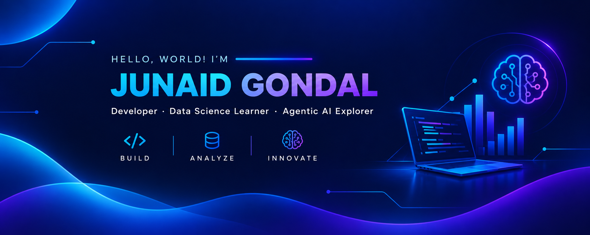

 

  

# 👋 Hey, I'm Junaid Gondal

### Web Developer · Data Science Learner · Agentic AI Explorer

*Build. Analyze. Innovate.*

[🌐 Projects](#-featured-projects) · [💻 Tech Stack](#-tech-stack) · [📊 Data Science](#-data-science) · [🤖 Agentic AI](#-agentic-ai) · [📈 GitHub Stats](#-github-statistics)

---

## 👨‍💻 About Me

I enjoy building modern web applications, discovering insights from data, and exploring intelligent AI agents. I'm focused on learning through practical projects and continuously strengthening my technical skills.

- 💻 Building responsive websites and exploring full-stack development
- 📊 Learning data analysis, statistics, and visualization with Python
- 🤖 Exploring LLMs, AI agents, tool calling, and agent memory
- 🌱 Improving through hands-on projects and consistent learning

---

## 💻 Tech Stack

### 🌐 Web Development

### 📊 Data Science

**Currently practicing**
- Data cleaning and preprocessing
- Exploratory Data Analysis (EDA)
- Descriptive statistics and correlation
- Data visualization using Matplotlib and Seaborn
- Business insights and performance metrics

**Next learning goals:** SQL, probability, statistical inference, machine learning, and model evaluation.

### 🤖 Agentic AI

- LLM integration and AI agent fundamentals
- Tool calling and custom tools
- LangChain and LangGraph fundamentals
- Short-term and long-term agent memory
- API integrations and JSON data handling
- Experiments with Gemini, weather, and GitHub APIs

### 🛠️ Developer Tools

---

## 🚀 Featured Projects

### 📈 Retail Sales Analysis

Exploratory analysis of a retail dataset containing **51,290 records**, using Python and data visualization to investigate business performance.

- Cleaned and analyzed data with Pandas
- Explored sales, profit, category, and shipping performance
- Created charts using Matplotlib and Seaborn
- Derived insights from retail performance metrics

**[View Repository →](https://github.com/junaid-gondal/Retail-sales-analysis)**

### 🍽️ Spice Garden Restaurant

A premium restaurant website project focused on elegant design, responsive layouts, menu browsing, gallery, contact, and reservations.

**[Explore My Repositories →](https://github.com/junaid-gondal?tab=repositories)**

### 🤖 AI Agent Experiments

Exploring LLM integrations, tool calling, memory systems, and API-connected agent workflows.

**[Explore My Repositories →](https://github.com/junaid-gondal?tab=repositories)**

---

## 📈 GitHub Statistics

---

## 🌱 My Learning Philosophy

I believe in learning by building. Every project helps me strengthen my fundamentals, solve practical problems, and move closer to becoming a skilled developer working across web technologies, data science, and AI.

**Learn → Build → Analyze → Improve → Repeat**

---

## 🤝 Let's Connect

I'm open to learning opportunities, collaboration, and meaningful projects.

- **GitHub:** [@junaid-gondal](https://github.com/junaid-gondal)
- **Repositories:** [Explore my projects](https://github.com/junaid-gondal?tab=repositories)

---

*Building today. Learning every day. Creating what's next.*

